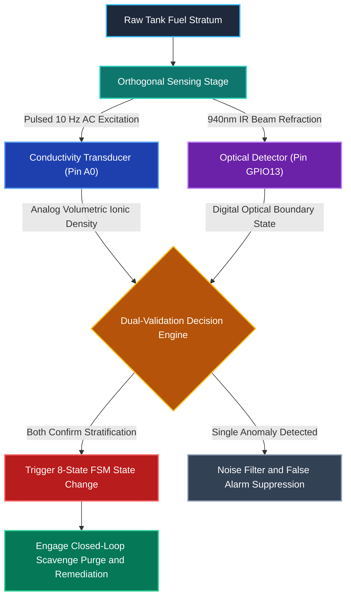
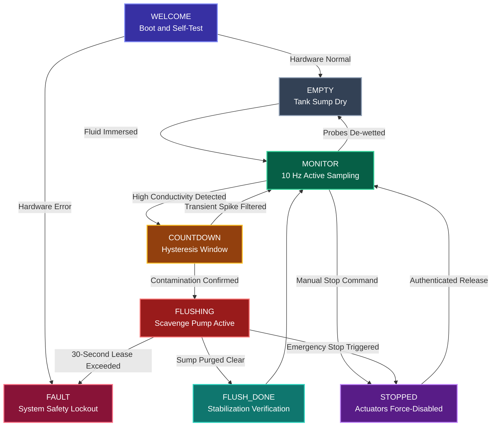

# FuelGuard

> Autonomous Dual-Sensing Fuel Quality Monitoring, Phase Separation Detection, and Closed-Loop Remediation System for Ethanol-Blended Gasoline.

[](https://devpost.com)
[](LICENSE)
[](https://www.espressif.com)
[](https://isocpp.org)
[](https://github.com/earlephilhower/littlefs-project)
[](data/)
[-8B5CF6?style=flat-square)](#bill-of-materials--hardware-budget)

---

## Technical Specifications at a Glance

| Parameter | Value | Engineering Context |
|:---|:---|:---|
| **Core Microcontroller** | 32-bit Tensilica L106 @ 80/160 MHz | Espressif ESP8266EX (NodeMCU V3) |
| **Detection Latency** | < 850 milliseconds | Sampling-to-state-transition threshold |
| **Excitation Modality** | 10 Hz Pulsed AC, 500 µs pulse width | Anti-electrolysis bipolar zero-plating design |
| **Optical Stage** | 940 nm Narrow-Beam IR + CdS Sensor | Resolves refractive index differences (1.33 vs 1.42) |
| **Primary Actuator** | 12V Diaphragm Pump (4.0 L/min) | Optocoupled scavenge purge for tank sump |
| **Secondary Actuator** | 12V Peristaltic Pump (120 mL/min) | Micro-dosing for chemical co-solvent remediation |
| **Local Display** | 1.3-inch 128x64 Monochrome OLED | 4-Wire Software SPI (SH1106 controller) |
| **Wireless Interface** | IEEE 802.11 b/g/n Wi-Fi SoftAP | Standalone local network (`FuelGuard` / WPA2-PSK) |
| **Web Server & UI** | Embedded LittleFS PWA Engine | Zero-cloud, local REST API + dynamic SVG oscilloscope |
| **Total Hardware Cost** | ~₹2,000 INR (~$24 USD) | Accessible, modular commercialization model |

---

## The Physical Problem

Global fuel standards increasingly mandate ethanol blending (E10, E20). While environmentally advantageous, ethanol is chemically hygroscopic: it scavenges ambient humidity from vented vehicular fuel tanks and storage cisterns.

When dissolved moisture exceeds the thermodynamic **Water Tolerance Limit (WTL)** (typically 0.4%–0.6% v/v depending on ambient temperature), the fuel undergoes macroscopic liquid-liquid phase separation:
1. **Upper Layer**: Octane-depleted gasoline fraction.
2. **Bottom Layer**: Dense, corrosive ethanol-water mixture that stratifies directly into the fuel pickup sump.

```
+---------------------------------------------------+
|               VENTED VEHICLE FUEL TANK            |
|                                                   |
|  [ Gasoline Hydrocarbon Layer - Octane Depleted ] |
|  Density: ~0.72 - 0.75 g/cm3                      |
|                                                   |
|~~~~~~~~~~~~~~~~ Phase Boundary ~~~~~~~~~~~~~~~~~~~|
|  [ Corrosive Water-Ethanol Phase Separation Slug ]|
|  Density: ~0.85 - 0.92 g/cm3                      |
|  +--------------------+   +--------------------+  |
|  | Conductivity Probe |   | Optical Refraction |  |
|  | A0 Sensing Point   |   | GPIO13 Threshold   |  |
|  +--------------------+   +--------------------+  |
|               |                     |             |
|   ============v=====================v===========  |
|  [ Sump Suction Pickup -> Engine Injection Pump ] |
+---------------------------------------------------+
```

### Why Existing Solutions Fail
* **Single Capacitive Sensors**: Suffer from mathematical ambiguity. Uncontaminated E25 fuel exhibits nearly the same dielectric constant ($\epsilon_r \approx 5.5\text{--}6.0$) as moisture-contaminated E10 fuel. A single capacitive transducer cannot reliably differentiate phase separation from higher legitimate ethanol content.
* **Laboratory Instrumentation (Karl Fischer Titration, GC)**: Highly accurate, but requires benchtop laboratory equipment costing over ₹10,00,000, rendering real-time, in-tank vehicular deployment impossible.

**FuelGuard** solves this by coupling an **orthogonal dual-sensing model** (pulsed electrical conductivity + optical transmission/refraction) with an **autonomous closed-loop purge mechanism**.

---

## Dual-Transducer Physical Sensing Principle



### 1. Pulsed AC Anti-Electrolysis Conductivity Transducer
Direct current (DC) passing through ethanol-water solutions causes rapid electrolytic plating, galvanic probe erosion, and hydrogen bubble formation within hours. 
* FuelGuard drives an NPN BJT switch connected to GPIO12 (`EXCITE`) that pulses the 316L stainless-steel electrodes for only **500 microseconds** per 10 Hz reading cycle.
* Probe voltage is sampled on analog pin `A0` (10-bit SAR ADC, 0–1023) through a high-precision voltage divider, ensuring negligible net charge transfer and zero galvanic degradation over prolonged immersion.

### 2. Optical Transmission and Refraction Interface
Ethanol-gasoline blends and aqueous slugs exhibit distinct refractive indices ($n \approx 1.42$ for gasoline vs $n \approx 1.33$ for the aqueous layer).
* A 940 nm narrow-beam infrared emitter shines through an optical sampling gap onto a CdS photoconductive sensor tied to GPIO13.
* When the aqueous boundary reaches the sensor plane, altered internal reflection and beam scattering instantly shift the digital logic level, confirming macroscopic separation without relying solely on conductivity.

---

## System Architecture

```
                       +-------------------------------+
                       |    ESP8266EX Microcontroller  |
                       |    32-bit Tensilica L106 Core |
                       +---------------+---------------+
                                       |
          +----------------------------+----------------------------+
          |                            |                            |
          v                            v                            v
+--------------------+       +--------------------+       +--------------------+
| Pulsed AC Sensing  |       | Optical Refraction |       |  I2C / SPI Display |
| Transducer (A0)    |       | Interface (GPIO13) |       |  SH1106 128x64 OLED|
+--------------------+       +--------------------+       +--------------------+
          |                            |
          +--------------+-------------+
                         |
                         v
          +----------------------------+
          |  8-State Decision Engine   |
          |  Deterministic FSM         |
          +--------------+-------------+
                         |
          +--------------+-------------+
          |                            |
          v                            v
+--------------------+       +--------------------+
| Sump Purge Relay   |       | Dosing Pump Relay  |
| GPIO16 (R1 Purge)  |       | GPIO2 (R2 Dose)    |
+--------------------+       +--------------------+
          |                            |
          v                            v
[12V Scavenge Diaphragm Pump]  [12V Peristaltic Dosing Pump]
```

---

## Hardware Pinout & GPIO Mapping

| Pin Name | NodeMCU Label | Peripheral Function | Electrical Characteristics |
|:---|:---|:---|:---|
| **A0 (TOUT)** | A0 | Analog Sensor Return | 0.0V–1.0V (10-bit SAR ADC input) |
| **GPIO12** | D6 | AC Pulse Drive (`EXCITE`) | 3.3V Logic, High-Speed Low-Duty-Cycle Pulse |
| **GPIO13** | D7 | Optical Refraction Detector (`LDR`) | Digital Input (Internal Pull-Up enabled) |
| **GPIO16** | D0 | Scavenge Purge Pump Relay (`R1`) | Active-Low Optocoupler Drive (12V Diaphragm Pump) |
| **GPIO2** | D4 | Chemical Dosing Pump Relay (`R2`) | Active-Low Optocoupler Drive (Peristaltic Dosing) |
| **GPIO4** | D2 | Alert / Fault LED (`RED`) | 3.3V Output via 330Ω Current-Limiting Resistor |
| **GPIO5** | D1 | Nominal Status LED (`GREEN`) | 3.3V Output via 330Ω Current-Limiting Resistor |
| **GPIO14** | D5 | Acoustic Alarm (`BUZZER`) | Active Piezo Transducer Drive |
| **GPIO15** | D8 | OLED Clock (`OLED_CS / CLK`) | 4-Wire Software SPI Clock Line |
| **GPIO0** | D3 | OLED Data (`OLED_MOSI`) | 4-Wire Software SPI Master-Out Slave-In |
| **TX (GPIO1)** | TX | OLED Command/Data (`OLED_DC`) | Dedicated Display Control Line (Hardware Serial Disabled) |

---

## Deterministic 8-State Finite State Machine (FSM)



### State Behavior Matrix

| State | OLED Display | Relays Active | Safety Invariant |
|:---|:---|:---|:---|
| `WELCOME` | Boot Splash, QR Code | None | Mount LittleFS, verify configuration JSON |
| `EMPTY` | "Tank Sump Empty" | None | Probes dry ($A_0 < 50$); actuators locked out |
| `MONITOR` | Live Sensor Waveform, Blending Metric | None | Sampling at 10 Hz; smoothing filters active |
| `COUNTDOWN` | Warning Screen, Countdown Timer | None | Hysteresis verification window (prevents splash false trips) |
| `FLUSHING` | "PURGING CONTAMINATED SLUG" | R1 (Purge Pump) | Maximum continuous runtime bounded to 30,000 ms |
| `FLUSH_DONE` | Verification Confirmation | None | 5-second stabilization post-scavenge |
| `STOPPED` | "EMERGENCY STOP / MANUAL" | None | Actuators force-de-energized; requires authenticated release |
| `FAULT` | Error Diagnostic Code, Audio Chirp | None | Lockout on probe short, open sensor, or lease overrun |

---

## Embedded Progressive Web Application (PWA)

FuelGuard embeds an offline-first, client-rendered web application directly into the ESP8266's on-chip SPI flash:

* **Zero Cloud Dependency**: Entirely self-hosted via `LittleFS`. No AWS, no Firebase, and no internet connection required.
* **Offline-First Caching**: Implemented with a standards-compliant Service Worker (`data/sw.js`) and Web Manifest (`data/manifest.webmanifest`).
* **Clean SVG UI**: Strict neo-brutalist industrial theme with zero emojis, crisp custom SVGs, and high readability in bright daylight or dark garage environments.
* **Real-Time Oscilloscope**: Pure JavaScript dual-trace canvas renderer displaying live conductivity curves against dynamic trigger thresholds.
* **Client-Side PDF Inspection Certificates**: Powered by embedded `jspdf` (`data/vendor/jspdf.umd.min.js`), generating compliance reports directly in the user's mobile browser.

### Accessing the Web Console
1. Power up the hardware rig. The SH1106 OLED automatically generates a scannable Wi-Fi QR code.
2. Connect to the device Wi-Fi:
   * **SSID**: `FuelGuard`
   * **Password**: `fuelguard123`
3. Open any modern browser and navigate to:
   * `http://fuelguard.local` or `http://192.168.4.1`

---

## RESTful Web API Reference

The onboard HTTP server exposes a JSON REST API for telemetry integration and supervisory control:

| Endpoint | Method | Auth Required | Purpose / Payload |
|:---|:---|:---|:---|
| `/api/status` | `GET` | No | Full telemetry: state, ADC reading, thresholds, relay states, uptime |
| `/api/logs` | `GET` | No | Circular buffer of recent state transitions with millisecond timestamps |
| `/api/calibration` | `GET` | No | Current reference calibration points and polynomial curve factors |
| `/api/login` | `POST` | No | Authenticate session token using device password |
| `/api/mode` | `POST` | Yes | Switch operating mode: `{"mode": "auto"}` or `{"mode": "manual"}` |
| `/api/pump` | `POST` | Yes | Trigger manual scavenge purge cycle: `{"duration": 3000}` |
| `/api/booster` | `POST` | Yes | Dispatch chemical stabilizer micro-dose: `{"dose_ms": 1500}` |
| `/api/stop` | `POST` | No | Immediate Emergency Stop (kills all relays, latches `STOPPED`) |
| `/api/heartbeat` | `POST` | Yes | Refresh safety lease timer during manual override sessions |
| `/api/calibration` | `POST` | Yes | Capture active voltage as a named calibration point (e.g., E10, E20) |
| `/api/calibration/cancel` | `POST` | Yes | Abort an in-progress multi-point calibration capture |
| `/api/calibration/delete` | `POST` | Yes | Reset stored calibration to factory firmware defaults |

---

## Bill of Materials & Hardware Budget

Strict cost discipline is maintained to ensure economic feasibility for fleet retrofits:

| Component | Key Specifications | Qty | Unit Cost (INR) | Subtotal (INR) |
|:---|:---|:---:|:---:|:---:|
| **ESP8266EX NodeMCU V3** | 32-bit Tensilica L106, 4MB Flash, Wi-Fi | 1 | ₹320 | ₹320 |
| **1.3" SH1106 OLED Display** | 128x64 Monochrome Graphic Screen, 4-Wire SPI | 1 | ₹280 | ₹280 |
| **Dual 5V Relay Module** | PC817 Optocoupled Isolation, 10A 250VAC Contacts | 1 | ₹150 | ₹150 |
| **316L Stainless Steel Probes** | Dual Acid-Resistant Sensing Electrodes | 2 | ₹50 | ₹100 |
| **Optical Stage (IR + CdS)** | 940 nm Narrow-Beam Emitter + 5528 Photocell | 1 | ₹50 | ₹50 |
| **LM2596S DC-DC Step-Down** | 9V–35V Input, 5V 3A Output Buck Converter | 1 | ₹100 | ₹100 |
| **12V Scavenge Diaphragm Pump** | Self-Priming 4.0 L/min, Viton Diaphragm Assembly | 1 | ₹650 | ₹650 |
| **12V Peristaltic Dosing Pump** | Fuel-Grade Silicone Tube, 120 mL/min Output | 1 | ₹200 | ₹200 |
| **Passives, Enclosure & PCB** | TVS diode, 1% resistors, caps, buzzer, FR4 | 1 | ₹150 | ₹150 |
| **TOTAL PROTOTYPE BOM** | **Complete Hardware Procurement Budget** | — | — | **₹2,000** |

---

## Flashing & Setup Guide

### 1. Development Prerequisites
* **Arduino IDE** (version 2.0+ recommended) or **Arduino CLI**.
* **ESP8266 Board Package**: version `3.1.2` or later.
* Required Libraries (install via Arduino Library Manager):
  * `ArduinoJson` (v6.21.5)
  * `U8g2` (v2.34+ by olikraus)
  * `ESP8266WiFi`, `ESP8266WebServer`, `LittleFS`, `Ticker` (bundled with ESP8266 core)

### 2. Board Configuration Settings
In the Arduino IDE **Tools** menu, select:
* **Board**: `NodeMCU 1.0 (ESP-12E Module)`
* **CPU Frequency**: `80 MHz` (or `160 MHz` for faster web rendering)
* **Flash Size**: `4MB (FS: 2MB OTA:~1019KB)` or `4MB (FS: 3MB)`
* **Upload Speed**: `921600` (or `115200` if serial connection is unstable)

### 3. Step-by-Step Build Steps
1. Clone this repository:
   ```bash
   git clone https://github.com/RizzWan-Codes/FuelGuard.git
   cd FuelGuard
   ```
2. Open `FuelGuard_final.ino` in the Arduino IDE.
3. Upload the LittleFS filesystem image using the **ESP8266 LittleFS Data Upload** tool to write the `data/` assets to flash.
4. Compile and flash the sketch to the ESP8266 over USB.
5. The SH1106 OLED will boot into the splash sequence and display the scannable Wi-Fi onboarding QR code.

---

## Safety & Operational Disclaimer

FuelGuard is an engineering prototype and bench demonstration platform. While low-voltage pulse excitation and optocoupled relay isolation are implemented throughout the electrical design, deploying sensing instrumentation inside production vehicle fuel systems requires certified explosion-proof enclosures, intrinsically safe Zener barrier isolation (e.g., ATEX / IECEx Zone 0 compliance), and specialized materials certified against ethanol chemical corrosion.

---

## License

Licensed under the Apache License, Version 2.0 (the "License"); you may not use this file except in compliance with the License. You may obtain a copy of the License at:

[http://www.apache.org/licenses/LICENSE-2.0](http://www.apache.org/licenses/LICENSE-2.0)

Unless required by applicable law or agreed to in writing, software distributed under the License is distributed on an "AS IS" BASIS, WITHOUT WARRANTIES OR CONDITIONS OF ANY KIND, either express or implied. See the [LICENSE](LICENSE) file for the specific language governing permissions and limitations under the License.
